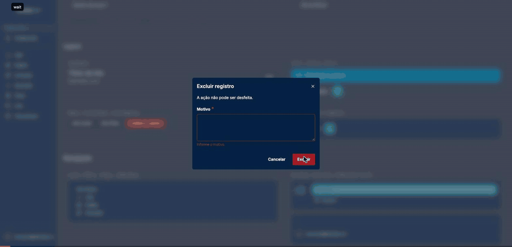

# houden-kit

Biblioteca de componentes React com Tailwind CSS 4 e DaisyUI 5: os temas `houdenTheme` e `houdenThemeDark`, formulários, tabela, layout autenticado com navegação lateral, painel e chat.

A lib não tem regra de negócio, autenticação nem cliente HTTP. Ela nasceu do port 1 para 1 dos componentes de um app React interno (o app de origem), com as mesmas classes, o mesmo markup e as mesmas props. Por isso o próprio app de origem pode migrar para ela trocando o caminho dos imports. O [PORTING.md](./PORTING.md) registra a origem de cada componente.



O percurso acima foi gravado no Chrome com o playground sob a CSP exigida pela lib, sem nenhuma violação nem erro no console.

## Instalação

```bash
npm install houden-kit react react-dom react-hook-form tailwindcss @tailwindcss/vite
```

| Dependência | Versão | Papel |
| --- | --- | --- |
| `react`, `react-dom` | 19 | Peer |
| `tailwindcss` | 4.1 | Peer. É o Tailwind do app que gera o CSS da lib |
| `react-hook-form` | 7 | Peer. Os campos com `Controller` (DatePicker, InputCurrency, MaskedInput, MultiSelect, InputChips) usam em runtime |
| Node | 20.19 ou mais novo | Mínimo do Vite 7 |

O DaisyUI vem fixado na lib (5.5.14), porque até um patch muda o CSS gerado.

## CSS em três linhas

No CSS de entrada do app:

```css
@import "tailwindcss";
@import "houden-kit/theme.css";
@import "houden-kit/fonts.css";
```

Com o Vite, use o plugin do Tailwind:

```ts
import tailwindcss from '@tailwindcss/vite'
import react from '@vitejs/plugin-react'
import { defineConfig } from 'vite'

export default defineConfig({
    plugins: [react(), tailwindcss()],
})
```

O que cada arquivo traz:

| Arquivo | Conteúdo |
| --- | --- |
| `houden-kit/theme.css` | `@plugin "daisyui"`, os dois temas, a variante `dark:`, as regras globais que os componentes usam, as animações, o CSS do react-toastify e um `@source` apontando para o próprio `dist` |
| `houden-kit/fonts.css` | Inter variável servida do pacote e `--font-sans`. Fica separado para um app Next.js poder manter o `next/font` |

A lib não entrega CSS pré-compilado. O `@source` do `theme.css` faz o Tailwind do app escanear os componentes compilados, e as classes usadas só dentro da lib saem no mesmo CSS que o app gera. Com uma passada só, a mesma utility nunca aparece em duas folhas, e combinações como `hidden md:flex` não invertem de ordem.

## Uso

Exports nomeados no barrel, ou import profundo com default export, no mesmo formato do app de origem:

```tsx
import { Button, Input, PageHeader } from 'houden-kit'
import DeepButton from 'houden-kit/components/Form/Button'

export function Exemplo() {
    return (
        <>
            <PageHeader title="Clientes" actions={<Button>Novo</Button>} />
            <Input labelText="Nome" placeholder="Digite o nome" />
            <DeepButton isLoading>Salvando</DeepButton>
        </>
    )
}
```

Os componentes com estado ou efeito trazem `'use client'`, preservado no build, então funcionam no App Router do Next.js.

### Ícones e tabela

O app não precisa importar o `lucide-react` nem o `@tanstack/react-table` diretamente. As duas bibliotecas são reexportadas, e o tree-shaking do bundler remove o que não for usado:

```tsx
import { TanStackTable } from 'houden-kit'
import { Eye } from 'houden-kit/icons'
import { type ColumnDef, getCoreRowModel, useReactTable } from 'houden-kit/table'

interface Pedido {
    numero: string
    total: number
}

const colunas: ColumnDef<Pedido>[] = [
    { accessorKey: 'numero', header: 'Pedido' },
    { accessorKey: 'total', header: 'Total' },
]

export function Pedidos({ pedidos }: { pedidos: Pedido[] }) {
    const table = useReactTable({ data: pedidos, columns: colunas, getCoreRowModel: getCoreRowModel() })
    return (
        <>
            <Eye size={16} />
            <TanStackTable table={table} />
        </>
    )
}
```

Para tabelas no formato antigo do app de origem (`name`, `selector`, `cell`), o `useLegacyTanStackTable` monta a instância e a paginação, que vai para a `TanStackPaginationBar`.

## Layout, navegação e roteador

O `AppShell` reproduz o layout autenticado do app de origem: barra de progresso, navegação lateral e área de conteúdo. A `Sidebar` recebe o menu já filtrado por permissão, porque a lib não conhece regra de acesso, e a rota atual vem por prop. O link interno passa por `linkComponent`, que por padrão é `'a'`.

Com o react-router, que usa `to` no lugar de `href`, o adaptador tem uma linha:

```tsx
import {
    AppShell,
    type IMenuSection,
    type LinkComponentProps,
    Loader,
    Sidebar,
    SidebarUserProfile,
    Toaster,
} from 'houden-kit'
import { LayoutGrid, List } from 'houden-kit/icons'
import { Link, Outlet, useLocation } from 'react-router'

function RouterLink({ href, ...props }: LinkComponentProps) {
    return <Link to={href} {...props} />
}

const menu: IMenuSection[] = [
    {
        id: 'vendas',
        label: 'Vendas',
        icon: LayoutGrid,
        items: [{ id: 'pedidos', label: 'Pedidos', searchTerms: ['pedidos'], href: '/pedidos', icon: List }],
    },
]

export function Layout({ email, onSignOut }: { email: string; onSignOut: () => void }) {
    const { pathname } = useLocation()
    return (
        <>
            <Toaster />
            <Loader />
            <AppShell
                pathname={pathname}
                sidebar={
                    <Sidebar
                        menu={menu}
                        pathname={pathname}
                        linkComponent={RouterLink}
                        defaultVariant="rail"
                        userProfile={({ isSidebarFullWidth }) => (
                            <SidebarUserProfile isSidebarFullWidth={isSidebarFullWidth} email={email} onSignOut={onSignOut} />
                        )}
                    />
                }
            >
                <Outlet />
            </AppShell>
        </>
    )
}
```

| Prop da Sidebar | O que faz |
| --- | --- |
| `menu` | Menu já filtrado pelo app. A lib aplica só a busca do campo "Buscar menu..." |
| `pathname` | Rota atual, usada para marcar o item ativo |
| `linkComponent` | Componente de link (padrão `'a'`) |
| `variant`, `defaultVariant` | `legacy` (barra larga) ou `rail` (trilho de 72 px com painel). Sem `variant`, valem o parâmetro `?sidebar=` da URL e a escolha salva em `houden-kit.sidebarVariant` |
| `logo` | Slot do logo, padrão o `Logo` em texto "Houden-kit". Aceita um nó ou uma função `({ compact }) => nó` |
| `userProfile` | Slot do rodapé. Aceita um nó ou uma função `({ isSidebarFullWidth }) => nó` |
| `isHidden` | Esconde a barra (telas de impressão, relatório em tela cheia) |
| `isCollapsed` | Barra legada recolhida, que expande com o ponteiro em cima |

### Barra de progresso

O `RouteProgressBar` (dentro do `AppShell`) começa a andar no clique em link interno e termina quando o `pathname` muda. Na navegação programática, dispare o evento antes de navegar:

```tsx
import { dispatchNavigationStart } from 'houden-kit'
import { useNavigate } from 'react-router'

export function useNavigateWithProgress() {
    const navigate = useNavigate()
    return (to: string) => {
        dispatchNavigationStart(to)
        navigate(to)
    }
}
```

O evento é `navigation:start` em `window` (constante `NAVIGATION_START_EVENT`).

### Loader

O `Loader` é o overlay bloqueante de operações longas. Ele conta requisições: só some quando cada `startLoading` tem o seu `stopLoading`. A API é a mesma do store do app de origem, então um interceptor do cliente HTTP chama assim:

```tsx
import { startLoading, stopLoading, useLoaderStore } from 'houden-kit'

export async function comLoader<T>(operacao: () => Promise<T>): Promise<T> {
    startLoading()
    try {
        return await operacao()
    } finally {
        stopLoading()
    }
}

// Mesma forma do Zustand, para quem migra do app de origem
export const iniciar = () => useLoaderStore.getState().startLoading()
```

## Tema

`houdenTheme` (claro, padrão) e `houdenThemeDark`. O `ThemeProvider` aplica `data-theme` no `<html>`, grava a escolha em `houden-kit.theme` e, sem escolha salva, segue o `prefers-color-scheme` do sistema. Para não piscar o tema claro sem usar script inline, chame `applyStoredTheme()` antes do primeiro render:

```tsx
import { applyStoredTheme, ThemeProvider, useTheme } from 'houden-kit'
import { createRoot } from 'react-dom/client'

applyStoredTheme()

function AlternarTema() {
    const { isDark, toggleTheme } = useTheme()
    return (
        <button type="button" className="btn btn-ghost" onClick={toggleTheme}>
            {isDark ? 'Tema claro' : 'Tema escuro'}
        </button>
    )
}

createRoot(document.getElementById('root') as HTMLElement).render(
    <ThemeProvider>
        <AlternarTema />
    </ThemeProvider>,
)
```

As classes `dark:` do Tailwind valem dentro de `[data-theme="houdenThemeDark"]`.

## CSP

A lib funciona sem `unsafe-inline` e sem CDN, sob este header:

```text
Content-Security-Policy: default-src 'self'; connect-src 'self'; img-src 'self' data:
```

| Item | Por quê |
| --- | --- |
| `img-src 'self' data:` | O DaisyUI desenha o spinner (`.loading`), a ponta do `chat-bubble`, os `loading-dots` e o ruído do tema (`--fx-noise`) com SVG em `data:` no `mask-image`. Sem essa diretiva, o navegador bloqueia essas imagens (e só elas). Imagem `data:` não executa script |
| Sem `unsafe-inline` | Não há CSS-in-JS nem `<style>` injetado. O react-toastify fica na versão 10, cujo CSS vem no `theme.css`. Alturas e larguras calculadas em runtime usam `element.style`, que a CSP permite |
| Sem CDN | A Inter vem do pacote (`fonts.css`), e os ícones são SVG em React |
| `build.assetsInlineLimit: 0` no Vite | O padrão do Vite embute arquivos de até 4 KB como `data:`, o que um `font-src`/`default-src 'self'` bloqueia. Com `0`, tudo sai como arquivo da mesma origem |

O playground prova isso: o `npm run playground:check-csp` abre as oito telas no Chrome headless, nos dois temas e nas duas variantes da Sidebar. Com o header acima, ele não registra nenhuma violação. Com `default-src 'self'; connect-src 'self'`, ele registra só os bloqueios de imagem `data:`.

## Componentes

| Grupo | Componentes |
| --- | --- |
| Formulário | Button, Checkbox, DatePicker, DatePickerFormGroup, DatePickerGroup, FormError, Input, InputChips, InputCurrency, InputCurrencyFormGroup, InputFile, Label, MaskedInput, MultiSearchSelect, MultiSelect, MultiSelectFormGroup, SearchInput, SearchSelect, Select, TextArea, TextAreaFormGroup |
| Tabela | TanStackTable, TanStackPaginationBar, useLegacyTanStackTable |
| Layout | Alert, AppShell, Aside, Avatar, ConfirmDialog, FilterDrawer, LiMenu, Loader, Logo, Modal, PageHeader, RouteProgressBar, Toaster, Tooltip, UlMenu |
| Navegação | Sidebar, SidebarProvider, SidebarUserProfile, SidebarMenu, RailBar, RailItem, ContextPanel, PanelItem, useSidebarContext, useActiveMenuItem, useSidebarVariant, filterMenuBySearch |
| Painel | DashboardCard, ChartCard, Chart |
| Chat | ChatBubble, ChatMessageList, ChatComposer, MarkdownContent, MessageTimestamp |
| Tema e utilitários | ThemeProvider, useTheme, applyStoredTheme, useClickOutside, toastSuccess, toastError |

O [playground](./playground) mostra todos eles numa galeria e em sete padrões de tela: lista, detalhe, formulário, aprovação, painel, chat e personalizado.

## Compatibilidade com o app de origem

A versão 0.1.0 é a linha de base verificável contra o app de origem (commit `1e5c1c3e`). Um teste de paridade renderiza cada componente portado nos dois projetos e compara o HTML.

A única diferença visual é a dos ícones, que são todos do `lucide-react`, sem FontAwesome. Os defeitos que vieram do app de origem (classes `undefined`, classes sem definição, lacunas de acessibilidade) ficaram como estão. Eles estão listados no [PORTING.md](./PORTING.md) e são corrigidos a partir da 0.2.0, um por versão.

## Desenvolvimento

```bash
npm install
npm test                 # Vitest: testes migrados do app de origem, novos e paridade
npm run lint             # Biome
npm run typecheck
npm run build            # dist módulo a módulo, com 'use client' e .d.ts
npm run test:dist        # varredura do dist
npm run check:package    # publint e arethetypeswrong
npm run check:consumer   # app Vite que instala o tarball
npm run playground:dev   # galeria e padrões de tela
```

Para regenerar as fixtures de paridade, é preciso ter o repositório do app de origem com dependências instaladas, indicado em `PARITY_SOURCE_DIR`:

```bash
PARITY_SOURCE_DIR=/caminho/do/app npm run parity:extract
PARITY_SOURCE_DIR=/caminho/do/app npm run parity:generate
```

A arquitetura e os guias para adicionar componentes ficam em [docs/ARQUITETURA.md](./docs/ARQUITETURA.md).

## Versionamento

SemVer, com [Changesets](https://github.com/changesets/changesets). Toda mudança publicada leva um changeset (`npm run changeset`), e o histórico fica no [CHANGELOG.md](./CHANGELOG.md).

## Licença

[MIT](./LICENSE)
