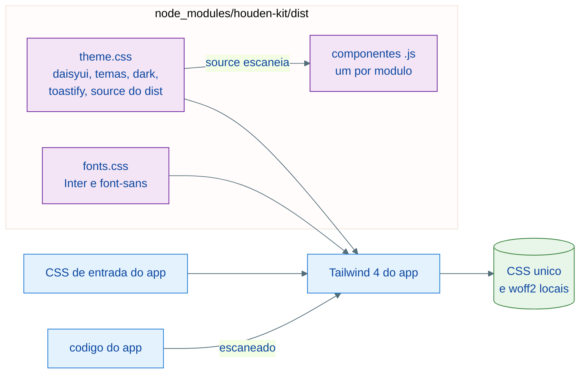
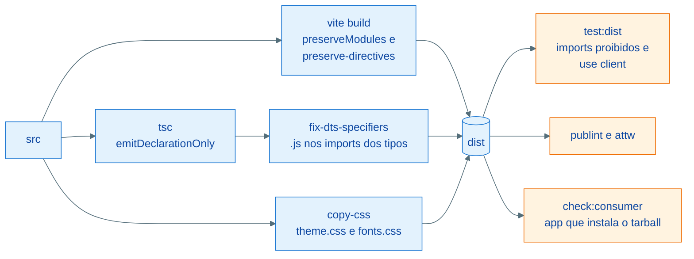
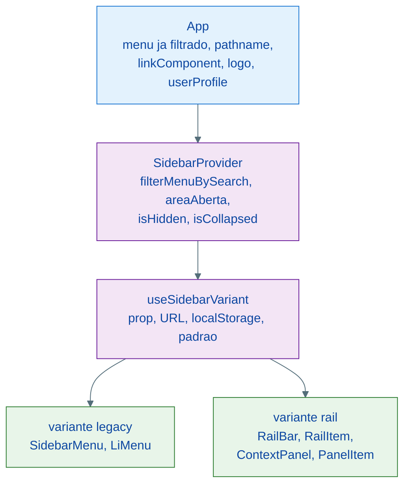
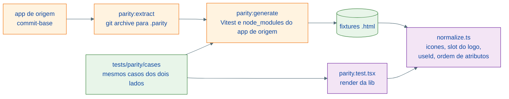

# Arquitetura: houden-kit

O houden-kit é uma biblioteca de UI em React, Tailwind CSS 4 e DaisyUI 5, nascida do port dos componentes de um app interno (o app de origem). Ela tem três compromissos, que explicam quase todas as decisões deste documento:

| Compromisso | Consequência |
| --- | --- |
| Port 1 para 1 do app de origem na 0.1.0 | Mesma estrutura de pastas, mesmo markup, mesmas classes e props; um teste de paridade prova a igualdade; os defeitos herdados ficam documentados no `PORTING.md` |
| Sem regra de negócio | O que no app de origem vinha de sessão, grants, stores ou Next.js chega por prop ou por slot |
| CSP sem `unsafe-inline` | Nada de CSS-in-JS nem `<style>` injetado; fontes e ícones vêm do pacote |

## Visão geral do pacote

| Pasta | Conteúdo |
| --- | --- |
| `src/components/{Form,Layout,TanStackTable,Dashboard,Chart,Chat}` | Componentes, na mesma estrutura do `src/components` do app de origem |
| `src/hooks`, `src/utils`, `src/types` | `useClickOutside`, toasts, `IOption`, tipos de menu e de link |
| `src/theme` | `ThemeProvider`, `useTheme`, `applyStoredTheme` |
| `src/icons`, `src/table` | Reexports de `lucide-react` e `@tanstack/react-table` |
| `src/styles` | `theme.css` e `fonts.css`, copiados para a raiz do `dist` |
| `tests/parity` | Casos, fixtures e normalizador da paridade com o app de origem |
| `playground/` | App Vite de referência: galeria e sete padrões de tela |

## Entrega do CSS

A lib não compila CSS. O consumidor importa o `theme.css`, que registra o DaisyUI e um `@source` para o próprio `dist`, e o Tailwind do app gera um CSS único com as classes do app e as da lib.



Uma passada só de Tailwind evita que a mesma utility apareça em duas folhas com ordem diferente. O mesmo formato serve ao app de origem quando ele migrar, porque ele já tem o próprio Tailwind.

O `theme.css` copia trechos do `src/styles/globals.css` do app de origem: temas, variante `dark`, regras de campos e do Select, e as animações. As linhas copiadas estão listadas no `PORTING.md`:

```css
@plugin "daisyui";

@plugin "daisyui/theme" {
    name: "houdenTheme";
    default: true;
    /* ... */
}

@custom-variant dark (&:where([data-theme="houdenThemeDark"], [data-theme="houdenThemeDark"] *));

@source "./";
```

## Build

O build gera ESM módulo a módulo, para preservar o `'use client'` de cada arquivo (o App Router do Next.js exige a diretiva no módulo que a declara) e para o tree-shaking do consumidor trabalhar por componente.



| Etapa | Arquivo | Detalhe |
| --- | --- | --- |
| JS | `vite.config.ts` | Toda dependência é externa; todo módulo de `src/components` é entrada, para nenhum export nomeado sair no tree-shaking |
| Diretivas | `rollup-preserve-directives` | O Rollup remove diretivas de módulo por padrão |
| Tipos | `tsconfig.build.json`, `scripts/fix-dts-specifiers.mjs` | Os imports relativos do código ficam sem extensão, como no app de origem; o script põe `.js` ou `/index.js` nos `.d.ts`, para a resolução `node16` |
| Exports | `package.json` | `./components/*` para os diretórios e chaves explícitas para os três módulos de arquivo que o app de origem importa fundo (`RouteProgressBar`, `TanStackPaginationBar`, `useLegacyTanStackTable`) |

A varredura do `dist` (`tests/dist-scan.test.ts`) confere duas coisas: que nenhum arquivo importa `next/*`, `zustand`, `@tanstack/react-query`, `@fortawesome`, `@/` ou `~/`, e que a lista de módulos com `'use client'` no `src` é a mesma do `dist`.

## Componentes adaptados: a Sidebar

A Sidebar do app de origem já separava a camada compartilhada (provider) da apresentação (variantes). A adaptação trocou as fontes de dado do provider por props e manteve as variantes.



| No app de origem | Na lib |
| --- | --- |
| `useSidebarMenu` (grants, roles, módulos e busca) | Prop `menu`, já filtrada pelo app; `filterMenuBySearch` com a mesma busca |
| `usePathname()` | Prop `pathname`, lida do contexto pelo `useActiveMenuItem` |
| `next/link` | `linkComponent` (via `useLinkComponent`, que cai em `'a'` fora do provider) |
| `next/image` com o logo da Houden | Slot `logo`, padrão `Logo` em texto |
| `useAuthStore` e `useAuth` no perfil | Slot `userProfile`; o `SidebarUserProfile` recebe `email` e `onSignOut` |
| Rotas fixas que escondem ou recolhem a barra | Props `isHidden` e `isCollapsed` |

Os slots aceitam um nó ou uma função, porque a variante precisa informar o contexto em que desenha:

```tsx
export type Slot<Context> = ReactNode | ((context: Context) => ReactNode)

export function renderSlot<Context>(slot: Slot<Context> | undefined, context: Context): ReactNode {
    return typeof slot === 'function' ? slot(context) : slot
}
```

O Loader seguiu a mesma ideia: o `useLoaderStore` do Zustand virou um store próprio com `useSyncExternalStore`, na mesma forma (`useLoaderStore(seletor)`, `useLoaderStore.getState().startLoading()`), para o componente e o `ApiService` do app de origem mudarem só o import.

## Paridade com o app de origem

A paridade prova o port 1 para 1. Ela renderiza cada caso nos dois projetos e compara o HTML depois de normalizar só as exceções documentadas.



| Parte | Por quê |
| --- | --- |
| `git archive` para `.parity/source` | Só lê o repositório do app de origem; nada é escrito na árvore dele |
| Vitest e `node_modules` do próprio app de origem no gerador | O componente do app de origem e o Testing Library precisam da mesma cópia do React |
| Casos que recebem o módulo (`render: ({ default: Button }) => ...`) | O mesmo caso roda contra o app de origem e contra a lib |
| Fixtures versionadas | O CI não precisa do app de origem |
| `normalize.test.ts` | Prova que a comparação não é vazia: classe extra, ícone trocado ou atributo com outro valor fazem o teste falhar |

O normalizador troca cada SVG do FontAwesome ou do lucide por um marcador com o nome do ícone, passando o FontAwesome pelo mapa do requisito 11 da spec:

```ts
export const FA_TO_LUCIDE: Record<string, string> = {
    eye: 'eye',
    'eye-slash': 'eye-off',
    'magnifying-glass': 'search',
    xmark: 'x',
    // ...
}
```

## CSP

O playground roda o `vite preview` com o header CSP, e o `playground/scripts/check-csp.mjs` percorre as telas no Chrome headless. A lib exige `img-src 'self' data:` além do header do template, por causa dos SVG em `data:` que o DaisyUI usa em `mask-image`. O README detalha o header e o motivo de cada diretiva.

## Como adicionar um componente portado

1. Copiar o arquivo do app de origem no commit-base para o mesmo caminho em `src/components`, com `git -C <app de origem> show <commit>:<arquivo>`, sem reformatar.
2. Ajustar só imports: aliases `@/` e `~/` viram caminhos relativos, ícones FontAwesome viram lucide com `iconDefaults` (e entram no `FA_TO_LUCIDE` e no `PORTING.md`).
3. Migrar o teste da pasta `__tests__`, registrando no `PORTING.md` cada mudança de teste.
4. Escrever o caso em `tests/parity/cases`, rodar `npm run parity:extract && npm run parity:generate` e conferir que a paridade passa.
5. Se o arquivo não estiver formatado no app de origem, incluí-lo no primeiro bloco de `overrides` do `biome.json`. Se ele violar regras do Biome, incluí-lo no segundo bloco e registrar no `PORTING.md`.
6. Exportar no `src/index.ts` e acrescentar a linha no `PORTING.md` (o `tests/porting.test.ts` cobra).

## Como adicionar um componente novo

1. Criar em `src/components/<Grupo>/<Nome>/index.tsx`, com classes DaisyUI no estilo do app de origem e textos em pt-BR, e `'use client'` só se o componente tiver estado ou efeito.
2. Escrever os testes em `__tests__`. Componente novo segue todas as regras do Biome.
3. Exportar no barrel, registrar no `PORTING.md` como "Novo" e mostrar na galeria do playground (o `check-gallery.mjs` cobra).
4. Abrir um changeset `minor`.

## Como corrigir um defeito herdado

1. Escolher um item da tabela "Defeitos herdados" do `PORTING.md`.
2. Corrigir no componente e atualizar o caso de paridade. A correção muda o HTML; declare a diferença em `tests/parity/exceptions.ts` ou regenere as fixtures a partir de um app de origem que já tenha a correção.
3. Tirar o item da tabela e abrir um changeset `patch` com a descrição do defeito.
